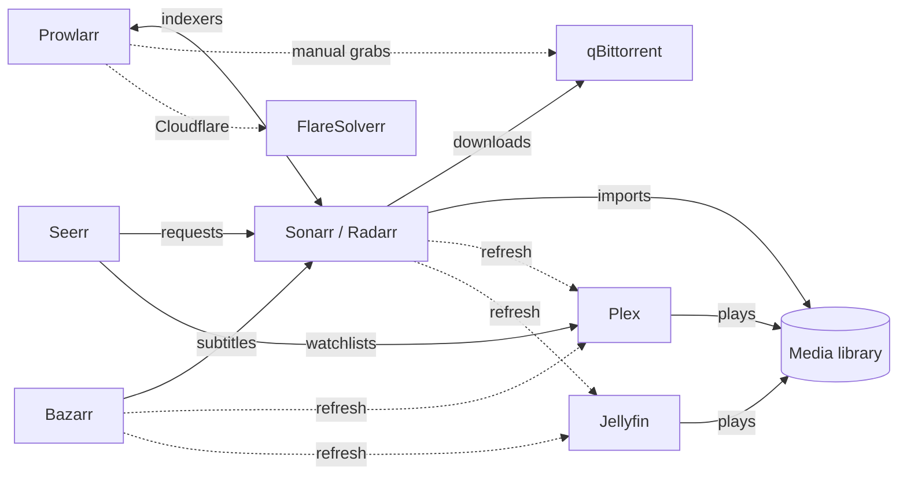

# Media

A self-hosted media stack: Plex, Jellyfin, Seerr, the *arr stack (Prowlarr, Sonarr, Radarr, Bazarr), FlareSolverr and qBittorrent behind a Gluetun VPN.

Users request titles in Seerr. Sonarr and Radarr find releases through Prowlarr and send them to qBittorrent, which downloads through the VPN. The finished downloads are imported into one shared library that both Plex and Jellyfin play, and Bazarr adds the subtitles. Apart from Plex, Jellyfin and Seerr, which have their own login, everything sits behind a Keycloak login.



Dotted arrows are optional connections. [Configure the apps](#configure-the-apps) explains how to make them, and [Connection details](#connection-details) lists each one.

Plex uses the official [chart](https://github.com/plexinc/pms-docker/tree/master/charts/plex-media-server), Jellyfin its official [chart](https://github.com/jellyfin/jellyfin-helm), Seerr its official [chart](https://docs.seerr.dev/getting-started/kubernetes), oauth2-proxy its official [chart](https://github.com/oauth2-proxy/manifests), the other apps use the [charts](https://github.com/M0NsTeRRR/helm-charts) of M0NsTeRRR, as there are no official charts for them.

## Prerequisites

Do these steps before installing.

1. **Chart repositories:** add them with:

   ```sh
   helm repo add plex https://raw.githubusercontent.com/plexinc/pms-docker/gh-pages
   helm repo add jellyfin https://jellyfin.github.io/jellyfin-helm
   helm repo add oauth2-proxy https://oauth2-proxy.github.io/manifests
   ```

2. **VPN credentials:** create the `vpn-credentials` secret with the settings of your VPN provider, e.g. for ProtonVPN:

   ```sh
   kubectl create secret generic vpn-credentials -n <namespace> --from-literal=VPN_SERVICE_PROVIDER=protonvpn --from-literal=VPN_TYPE=wireguard --from-literal=WIREGUARD_PRIVATE_KEY=<key> --from-literal=SERVER_COUNTRIES=<country>
   ```

   Generate a WireGuard configuration at [account.proton.me/vpn/WireGuard](https://account.proton.me/u/0/vpn/WireGuard) and use its `PrivateKey` as key, it works for all servers. For other providers see the [Gluetun wiki](https://github.com/qdm12/gluetun-wiki/tree/main/setup/providers). Restart the qBittorrent deployment after changing the secret, see [Restarting qBittorrent](#restarting-qbittorrent).

3. **Keycloak login:** the ingresses of all apps except Plex, Jellyfin and Seerr are protected by Keycloak through oauth2-proxy and the Traefik `keycloak-auth` middleware, and the login of Sonarr, Radarr and Prowlarr is disabled (`External`). A NetworkPolicy only allows traffic to all apps (including Plex, Jellyfin and Seerr) from the media pods and the `media.traefikNamespace`, so they can't be reached around the login from inside the cluster. Plex also accepts traffic on its port from `media.plexAllowedCidrs`. It has the fixed LoadBalancer IP `192.168.102.32` (`io.cilium/lb-ipam-ips` in the values) and advertises it with `ADVERTISE_IP`, so clients on those networks keep a stable address when the pod gets a new IP. Jellyfin has its own login. Create a `media` client in the [Keycloak Terraform](../keycloak/terraform/README.md), with `https://<global.oauth2ProxyIngressHost>/oauth2/callback` as redirect URI (and the `additional_redirect_uris` for Jellyfin, which uses the same client, see [Jellyfin](#jellyfin)), add the users that need access to the `media-users` group in Keycloak (removed users lose access within 24 hours, set by `cookie-expire` in the oauth2-proxy `extraArgs`) and create the `media-keycloak-secret` secret with:

   ```sh
   kubectl create secret generic media-keycloak-secret -n <namespace> --from-literal=client-secret=<secret> --from-literal=cookie-secret=$(openssl rand -base64 32 | tr -- '+/' '-_')
   ```

## Install

Install/upgrade with:

```sh
helm upgrade --install --debug --atomic --dependency-update --post-renderer media/post-renderer.sh -n <namespace> -f media/values.yaml --set media.ingressHosts.plex=<url> --set media.ingressHosts.jellyfin=<url> --set media.ingressHosts.qbittorrent=<url> --set media.ingressHosts.seerr=<url> --set media.ingressHosts.prowlarr=<url> --set media.ingressHosts.sonarr=<url> --set media.ingressHosts.radarr=<url> --set media.ingressHosts.bazarr=<url> --set global.oauth2ProxyIngressHost=<url> --set global.cookieDomain=<.domain> --set global.keycloakUrl=<url> media media
```

Apps without an entry in `media.ingressHosts` are only reachable inside the cluster, use `kubectl port-forward` for the initial setup (e.g. to claim Plex). All app hosts and `global.oauth2ProxyIngressHost` have to be subdomains of `global.cookieDomain`.

To transcode on an NVIDIA GPU, also add `-f media/values-nvidia.yaml` after `-f media/values.yaml`, see [Hardware transcoding](#hardware-transcoding-nvidia-optional).

## Settings

- **Hardening:** Jellyfin runs as user `1000` without capabilities, and an init container (`config-owner`) gives its config volume to that user on every start. Plex can't run as a non-root user, as its init system needs root, so its container starts as root with only the capabilities `CHOWN`, `DAC_OVERRIDE`, `FOWNER`, `SETUID` and `SETGID` and runs Plex itself as user `1000`. Both mount the library read-only, so they can't delete or change media files, which means Plex can't delete media either (`Allow media deletion`). None of the apps mounts the Kubernetes API token.
- **Plex address:** the Plex pod gets a new IP on every restart, so the `plex` service is a LoadBalancer with a fixed IP (`io.cilium/lb-ipam-ips` in the values) that Plex advertises with `ADVERTISE_IP`. Both have to use the same IP. `media.plexAllowedCidrs` are the networks that the NetworkPolicy allows to reach Plex directly, other than through Traefik.
- **Plex remote access:** away from home, Plex clients reach Plex through its Traefik ingress (`media.ingressHosts.plex`), not through Plex's own remote access, as port 32400 is not forwarded and the NetworkPolicy only lets Traefik and `media.plexAllowedCidrs` in. To make the clients use it, the ingress URL has to be one of the custom server access URLs of Plex (`Settings > Network`). The start script of the Plex image sets that setting from `ADVERTISE_IP` on every start, so a URL added only in the Plex settings is lost when the pod restarts. Add it to the install command instead, together with the fixed IP, comma separated and with the comma escaped for `--set`: `--set 'plex-media-server.extraEnv.ADVERTISE_IP=http://192.168.102.32:32400\,https://<plex host>:443'`, where the host is the one of `media.ingressHosts.plex`. Plex is not behind the Keycloak login, so it relies on its own authentication. Plex's own `Remote Access` page then shows `Not available outside your network`, as it only checks port 32400 (or a manual port) through plex.tv and not this route, and the clients still connect through the custom URL. Leave the manual port mapping off: plex.tv checks it with a `plex.direct` hostname, which Traefik rejects with its `sniStrict` TLS option. Set `LAN Networks` under `Settings > Network` to the networks of `media.plexAllowedCidrs`, as Plex otherwise treats clients on the LAN as remote.
- **Startup probes:** the charts of Sonarr, Radarr, Prowlarr, Bazarr and qBittorrent have no option for a startup probe, so `post-renderer.sh` adds them (requires `kubectl`). Without it the apps still deploy, but a slow start (e.g. a database migration) can be killed by the liveness probe. The startup probes of Plex and Seerr are set in `values.yaml`.
- **Gluetun server list:** Gluetun refreshes the server list of the VPN provider every 24 hours (`UPDATER_PERIOD` in `values.yaml`), as the list built into the image gets outdated. When that happens the tunnel can't be set up, the Gluetun container (named `gluten` in the chart) fails its health checks and qBittorrent never becomes ready. For ProtonVPN no account credentials are needed for this, if the paid servers are missing add `UPDATER_PROTONVPN_EMAIL` and `UPDATER_PROTONVPN_PASSWORD` to the `vpn-credentials` secret.
- **qBittorrent preferences:** they are applied on start by a sidecar from the `qbittorrent-preferences` ConfigMap (`templates/qbittorrent-preferences.yaml`), [restart](#restarting-qbittorrent) the qBittorrent deployment after changing them. The number of concurrent downloads (`media.qbittorrentPreferences.maxActiveDownloads`, default `5`), the seeding ratio (`maxRatio`, default `0`) and the seeding time in minutes (`maxSeedingTime`, default `4320`, i.e. 3 days) are set in `values.yaml`. Torrents are paused when either limit is reached, with the default ratio `0` seeding is effectively disabled. Enable `Remove Completed` in the download client of Sonarr and Radarr to remove the paused torrents and their downloads after the import, the library keeps its hardlinked copy. Do not use `max_ratio_act` `1` or `3`, as they remove a torrent before the import.

## Restarting qBittorrent

Restart the qBittorrent deployment with:

```sh
kubectl rollout restart -n <namespace> deploy/qbittorrent
kubectl rollout status -n <namespace> deploy/qbittorrent
```

This is needed when only the contents of the `vpn-credentials` secret or the `qbittorrent-preferences` ConfigMap change, as Gluetun reads its environment from the secret and the preferences sidecar applies the ConfigMap only when the pod starts. Pods don't pick up changes to them while running, and since the pod spec itself doesn't change, `helm upgrade` doesn't restart them either. An upgrade that does change the pod spec, such as new `extraEnv` entries, restarts it by itself.

The deployment uses the `Recreate` strategy, so qBittorrent is briefly down during the restart and its downloads resume afterwards. The configuration and torrents are kept on the persistent volume.

## Peer-to-peer (optional)

Without an incoming port qBittorrent can only connect to peers that accept connections, which makes downloads slower and some torrents unreachable. To get an incoming port the VPN provider has to forward one, which Gluetun supports natively for ProtonVPN, Private Internet Access, Perfect Privacy and PrivateVPN. Other providers have to forward the port themselves, see the [Gluetun wiki](https://github.com/qdm12/gluetun-wiki/blob/main/setup/advanced/vpn-port-forwarding.md).

1. **Provider:** for ProtonVPN generate the WireGuard configuration with `NAT-PMP (Port Forwarding)` enabled, and add `PORT_FORWARD_ONLY=on` to the `vpn-credentials` secret so only servers with port forwarding are used. Make sure the `SERVER_COUNTRIES` have such servers.
2. **Gluetun:** add these entries to `qbittorrent.qbittorrent.gluetun.extraEnv` in `values.yaml`. Gluetun opens the forwarded port in its firewall itself, and the command sets it as the listening port of qBittorrent each time it changes.

   ```yaml
   - name: VPN_PORT_FORWARDING
     value: "on"
   - name: VPN_PORT_FORWARDING_UP_COMMAND
     value: /bin/sh -c 'wget -O- -nv --retry-connrefused --post-data "json={\"listen_port\":{{PORT}},\"current_network_interface\":\"{{VPN_INTERFACE}}\",\"random_port\":false,\"upnp\":false}" http://127.0.0.1:8080/api/v2/app/setPreferences'
   - name: VPN_PORT_FORWARDING_DOWN_COMMAND
     value: /bin/sh -c 'wget -O- -nv --retry-connrefused --post-data "json={\"listen_port\":0,\"current_network_interface\":\"lo\"}" http://127.0.0.1:8080/api/v2/app/setPreferences'
   ```

3. **Apply:** upgrade the release and [restart](#restarting-qbittorrent) the qBittorrent deployment after changing the secret. The commands reach qBittorrent without a login as it skips authentication for localhost, the same way the preferences sidecar does.
4. **Check:** the forwarded port is logged by the Gluetun container (named `gluten` in the chart), and qBittorrent should show the same `Listening port` under `Options > Connection`, with a green connection status at the bottom of the interface:

   ```sh
   kubectl logs -n <namespace> deploy/qbittorrent -c gluten | grep -i "port forward"
   ```

The forwarded port changes when the VPN reconnects, so don't set the listening port in `media.qbittorrentPreferences` or open it by hand with `FIREWALL_VPN_INPUT_PORTS`.

## Prepare the volume

In the apps, use `/data/torrents` as download directory and `/data/media/<type>` for the libraries, and connect to the other apps with their service name (e.g. `http://qbittorrent-web`).

Create the directories on the media volume first, the apps don't create them:

```sh
kubectl exec -n <namespace> deploy/sonarr -- mkdir -p /data/media/tv /data/media/movies /data/torrents
```

## Jellyfin

Jellyfin uses the same library as Plex: the media volume is mounted read-only at `/data`, so add the libraries `/data/media/movies` and `/data/media/tv` in its setup wizard or under `Dashboard > Libraries`.

Jellyfin has no built-in Keycloak support, and the Keycloak middleware would break its apps like it does for Plex. Users sign in with the [SSO plugin](https://github.com/9p4/jellyfin-plugin-sso) instead, which is archived (read-only since May 2026), so it gets no more updates. It only works in the Jellyfin web UI and in clients that support Quick Connect, other apps need a local Jellyfin account. This setup has not been tested with this chart, check the plugin README and its [Keycloak notes](https://github.com/9p4/jellyfin-plugin-sso/blob/main/providers.md) if something doesn't work.

1. **Keycloak client:** Jellyfin uses the same `media` client as oauth2-proxy, so its users and the `media-users` group are shared. Add `https://<media.ingressHosts.jellyfin>/sso/OID/redirect/keycloak` as an additional redirect URI to the client (and `org.jellyfin.mobile://login-callback` for the Android app, as the provider notes advise) (`keycloak` is the provider name used below, see the [Keycloak Terraform](../keycloak/terraform/README.md)). The secret is the same one as in `media-keycloak-secret`:

   ```sh
   kubectl get secret -n <namespace> media-keycloak-secret -o jsonpath='{.data.client-secret}' | base64 -d
   ```
2. **Plugin:** under `Dashboard > Plugins > Repositories` add a repository with `https://raw.githubusercontent.com/9p4/jellyfin-plugin-sso/manifest-release/manifest.json` as URL (the name is free, e.g. `SSO Authentication`), install `SSO Authentication` from the catalog and restart Jellyfin with `kubectl rollout restart -n <namespace> deploy/jellyfin`.
3. **Provider:** add it through the API of the plugin from inside the pod, with the login of a local Jellyfin administrator. The credentials and the secret go through stdin, so they don't show up in the process list, and a password with quotes or backslashes needs escaping in the JSON. `Roles` and the `groups` claim are the `media-users` group of the Keycloak mapper, and `schemeOverride` is needed as TLS ends at Traefik:

   ```sh
   read -rp 'Jellyfin admin user: ' JF_USER
   read -rsp 'Jellyfin admin password: ' JF_PASS; echo
   SECRET=$(kubectl get secret -n <namespace> media-keycloak-secret -o jsonpath='{.data.client-secret}' | base64 -d)
   kubectl exec -i -n <namespace> deploy/jellyfin -- sh <<EOF
   TOKEN=\$(curl -s -X POST http://localhost:8096/Users/AuthenticateByName -H 'Content-Type: application/json' -H 'Authorization: MediaBrowser Client="kubectl", Device="kubectl", DeviceId="kubectl", Version="1"' -d '{"Username":"$JF_USER","Pw":"$JF_PASS"}' | sed -n 's/.*"AccessToken":"\([^"]*\)".*/\1/p')
   curl -s -X POST -H 'Content-Type: application/json' "http://localhost:8096/sso/OID/Add/keycloak?api_key=\$TOKEN" -d '{"oidEndpoint": "https://<global.keycloakUrl>/realms/homelab", "oidClientId": "media", "oidSecret": "$SECRET", "enabled": true, "enableAuthorization": true, "enableAllFolders": true, "enabledFolders": [], "roles": ["media-users"], "adminRoles": ["media-admins"], "folderRoleMapping": [], "roleClaim": "groups", "oidScopes": [""], "schemeOverride": "https"}'
   EOF
   ```

   `keycloak` in the URL is the provider name used in the redirect URI. Members of the `media-admins` group (in the [Keycloak Terraform](../keycloak/terraform/README.md)) become Jellyfin administrators at their next sign-in, and lose it again when removed. They also have to be in `media-users` to get through the Keycloak login of the other apps. The list settings (`enabledFolders`, `adminRoles`, `folderRoleMapping` and `oidScopes`) have to be present even when empty, otherwise the login fails with `Error processing request.` in Jellyfin. The settings are the ones from the plugin's [README](https://github.com/9p4/jellyfin-plugin-sso) and [provider notes](https://github.com/9p4/jellyfin-plugin-sso/blob/main/providers.md), they can also be edited under `Dashboard > Plugins > SSO-Auth`.
4. **Login button:** the plugin doesn't add one. Under `Dashboard > General > Branding` add this to the `Login disclaimer`, with the Jellyfin host:

   ```html
   <form action="https://<media.ingressHosts.jellyfin>/sso/OID/start/keycloak">
     <button class="raised block emby-button button-submit">Sign in with Keycloak</button>
   </form>
   ```

A Keycloak user with the same name as an existing local Jellyfin user takes over that account's permissions, so check the existing users first, and keep the local administrator account as a fallback.

## Hardware transcoding (NVIDIA, optional)

Plex and Jellyfin can transcode on an NVIDIA GPU in the node instead of on the CPU. The NVIDIA container runtime hands the GPU to the pods, K3s adds it as the `nvidia` RuntimeClass when the NVIDIA Container Toolkit is installed on the node. There is no device plugin, so the GPU is not a scheduled Kubernetes resource: Plex and Jellyfin share it without limits, and any pod that sets `runtimeClassName: nvidia` and `NVIDIA_VISIBLE_DEVICES` gets it too.

1. **Node:** pass the GPU through to the VM, then install the driver and the container toolkit as described in the [Ansible README](../ansible/README.md#nvidia-gpu-optional). Check that `nvidia-smi` lists the GPU on the node and that K3s found the runtime:

   ```sh
   grep nvidia /var/lib/rancher/k3s/agent/etc/containerd/config.toml
   kubectl get runtimeclass nvidia
   ```
2. **Install:** add `-f media/values-nvidia.yaml` after `-f media/values.yaml` in the [install](#install) command, which restarts Plex and Jellyfin with the `nvidia` runtime. Add it to every upgrade, otherwise the apps lose the GPU again. Don't add it before the node has the runtime, as the pods can't start without it. The file also sets `LD_LIBRARY_PATH` for Plex to `/usr/lib/x86_64-linux-gnu/nvidia/current`, where the runtime puts the libraries of the Debian driver. Without it the Plex transcoder reports `Cannot load libcuda.so.1` and transcodes on the CPU (Plex's log then says `hardware transcoding: enabled, but no hardware decode accelerator found`). That path is specific to Debian's driver packages, which the [nvidia role](../ansible/README.md#nvidia-gpu-optional) installs.
3. **Plex:** hardware transcoding needs Plex Pass. Under `Settings > Server > Transcoder` turn on `Show Advanced` and `Use hardware acceleration when available`.
4. **Jellyfin:** under `Dashboard > Playback > Transcoding` select `Nvidia NVENC` as hardware acceleration and enable the decoders the GPU supports.
5. **Check:** start a transcode (e.g. play a title at a lower quality) and look for its process:

   ```sh
   kubectl exec -n <namespace> plex-0 -- nvidia-smi
   kubectl exec -n <namespace> deploy/jellyfin -- nvidia-smi
   ```

## Configure the apps

Do these steps first, the apps need them to work together. Hosts are the service names of the apps and SSL is off everywhere, as the traffic stays inside the cluster.

1. **Sonarr and Radarr, download client:** add qBittorrent under `Settings > Download Clients` with host `qbittorrent-web`, port `80`, an empty username and password (qBittorrent skips its login for the pod network) and the category `tv-sonarr` respectively `radarr` (the defaults, qBittorrent creates them). Enable `Remove Completed` and test the connection.
2. **Sonarr and Radarr, root folders:** add `/data/media/tv` respectively `/data/media/movies` under `Settings > Media Management` and keep `Use Hardlinks instead of Copy` enabled.
3. **Prowlarr, indexers:** add Sonarr and Radarr under `Settings > Apps` with `http://prowlarr` as the Prowlarr server, `http://sonarr` respectively `http://radarr` as the server and their API keys (`Settings > General` in those apps). Prowlarr then pushes its indexers to them, and Sonarr and Radarr search through Prowlarr, so both directions have to be reachable. Add the indexers in Prowlarr, they show up under `Settings > Indexers` in Sonarr and Radarr after the sync.
4. **Bazarr, subtitles:** connect Sonarr and Radarr under `Settings > Sonarr` and `Settings > Radarr` with host `sonarr` respectively `radarr`, port `80` and their API keys. Bazarr writes the subtitles next to the media files, so the paths of the apps have to be the same (`/data/media/<type>`).
5. **Seerr, requests:** sign in with Plex and connect Plex under `Settings > Plex` with host `plex` and port `32400`, and sync the libraries. Then add Sonarr and Radarr under `Settings > Services` with host `sonarr` respectively `radarr`, port `80`, their API keys, a quality profile and the root folder `/data/media/tv` respectively `/data/media/movies`. Seerr handles its own login, so its ingress is not behind Keycloak.

## Optional connections

These connections are not needed for the apps to work, but make them more convenient. Do them after the steps above, with the same hosts and SSL settings.

1. **Seerr, Plex watchlists:** import the Plex users under `Settings > Users` and give them the `Auto-Request` permission (or set it in the default permissions). Items a user adds to their Plex watchlist are then requested automatically, and the request is sent to Sonarr or Radarr. Only users that signed in with Plex have a watchlist.
2. **Sonarr and Radarr, library refresh:** add a connection under `Settings > Connect > Plex Media Server` with host `plex` and port `32400`, sign in with Plex and enable `On Import/Upgrade`, so Plex scans a new file right after the import instead of on its own schedule.
3. **Sonarr and Radarr, Jellyfin library refresh:** add a connection under `Settings > Connect > Emby / Jellyfin` with host `jellyfin` and port `8096`, the API key from `Dashboard > API Keys` in Jellyfin and `On Import/Upgrade` enabled, so Jellyfin scans a new file right after the import. Jellyfin also finds new files by itself.
4. **Bazarr, library refresh:** enable Plex under `Settings > Plex` with host `plex` and port `32400`, so Plex rescans after Bazarr downloaded subtitles.
5. **Bazarr, Jellyfin library refresh:** enable Jellyfin under `Settings > Jellyfin` with host `jellyfin`, port `8096`, SSL off and the API key from `Dashboard > API Keys` in Jellyfin, so Jellyfin rescans after Bazarr downloaded subtitles.
6. **Prowlarr, manual grabs:** add qBittorrent under `Settings > Download Clients` with host `qbittorrent-web`, port `80` and an empty username and password, to send a release to qBittorrent from the Prowlarr search. Sonarr and Radarr don't need this, they use their own download client.
7. **Prowlarr, FlareSolverr:** set `flaresolverr.enabled` to `true` and redeploy. Add it under `Settings > Indexers > Indexer Proxies` with host `http://flaresolverr` and a tag, and give the same tag to the indexers behind Cloudflare. It is disabled by default as it often fails to solve the challenges.

## Connection details

The arrows in the overview at the top, per connection. All connections use the service names and the service ports (`80`, `32400` for Plex, `8096` for Jellyfin), not the container ports of the apps, and are allowed by the NetworkPolicy, as every app only accepts traffic from the media pods and Traefik (Plex also from `media.plexAllowedCidrs`).

| From | To | Address | Purpose |
|---|---|---|---|
| Seerr | Plex | `http://plex:32400` | Sign-in with Plex, scan of the libraries for availability, and the watchlists of the users. With the `Auto-Request` permission and `Settings > Users` (import the Plex users), items a user adds to their Plex watchlist are requested automatically. |
| Seerr | Sonarr, Radarr | `http://sonarr:80`, `http://radarr:80` | Sends the requests and reads the quality profiles, root folders and tags to choose from. Availability of a request comes from the Plex scan. |
| Prowlarr | Sonarr, Radarr | `http://sonarr:80`, `http://radarr:80` | Pushes the indexers and keeps them in sync (`Settings > Apps`), needs the API keys of both. |
| Sonarr, Radarr | Prowlarr | `http://prowlarr:80` | Search the synced indexers through the proxy URL of Prowlarr, which is the `Prowlarr Server` set in Prowlarr. Both directions have to work, otherwise the indexers are synced but searches fail. |
| Sonarr, Radarr | qBittorrent | `http://qbittorrent-web:80` | Add torrents with a category and poll their state, then import and hardlink the files, and remove the torrent (`Remove Completed`). |
| Prowlarr | qBittorrent | `http://qbittorrent-web:80` | Optional, only to send a release to the download client from the Prowlarr interface (`Settings > Download Clients`), Sonarr and Radarr handle their own downloads. |
| Prowlarr | FlareSolverr | `http://flaresolverr:80` | Optional indexer proxy for indexers behind Cloudflare, only when `flaresolverr.enabled` is `true`. |
| Bazarr | Sonarr, Radarr | `http://sonarr:80`, `http://radarr:80` | Reads the series and movies and which subtitles are missing (`Settings > Sonarr` and `Settings > Radarr`), then writes the subtitles next to the media files. |
| Bazarr | Plex | `http://plex:32400` | Optional, refreshes the library after downloading subtitles (`Settings > Plex`). |
| Bazarr | Jellyfin | `http://jellyfin:8096` | Optional, refreshes the library after downloading subtitles (`Settings > Jellyfin`). |
| Sonarr, Radarr | Plex | `http://plex:32400` | Optional, `Settings > Connect > Plex Media Server` triggers a library scan after an import, Plex also finds new files by itself. |
| Sonarr, Radarr | Jellyfin | `http://jellyfin:8096` | Optional, `Settings > Connect > Emby / Jellyfin` triggers a library scan after an import, Jellyfin also finds new files by itself. |
| Traefik | oauth2-proxy | `http://oauth2-proxy:80` | ForwardAuth check of every request to the apps behind Keycloak. |
| oauth2-proxy | Keycloak | `global.keycloakUrl` | Login of the users of the `media-users` group. |
| Jellyfin | Keycloak | `global.keycloakUrl` | Login through the SSO plugin, see [Jellyfin](#jellyfin). |

Outside the pods:

- qBittorrent is the only app whose traffic goes through the VPN. Its Gluetun firewall only allows the pod and service CIDRs (`FIREWALL_OUTBOUND_SUBNETS`) and port `8080` inside the cluster, so the apps above can reach it, but it can't reach anything else locally.
- Seerr and Prowlarr need the internet (Plex, TMDB and the indexers), Sonarr and Radarr need it for metadata and the indexers.
- Sonarr, Radarr, Bazarr, Plex and qBittorrent share the `media` volume (`/data`), so the paths in the apps have to be the same for hardlinks and for Bazarr to find the files. Jellyfin mounts it read-only. Prowlarr and Seerr don't mount it.
